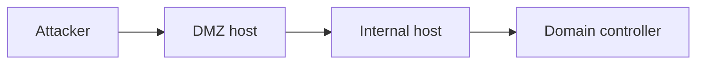

# {{LAB_NAME}}: HTB Pro Lab

| | |
|---|---|
| **Lab** | Dante / Offshore / RastaLabs / … |
| **Level** | |
| **Dates** | YYYY-MM-DD → YYYY-MM-DD |
| **Flags / completion** | x / y |

> ⚠️ **Publish only what HTB allows for this lab.** No flags, credentials or hashes. Keep the writeup high-level where the lab is still active.

## Overall objective

What the lab simulates and what the end goal is.

## Network diagram

<!-- Replace with a diagram (draw.io / Mermaid / image in an assets folder) -->

## Hosts

| Host | Role | Foothold | Privesc | Pivot used |
|---|---|---|---|---|
| | | | | |

## Attack path (summary)

1. Initial access:
2. Pivot into internal network:
3. Lateral movement:
4. Domain / final objective:

## What this lab taught me about real-world environments

- **Network segmentation:** what was flat that should not have been
- **Trust relationships:** shared credentials, service accounts, domain trusts
- **Hardening lessons:** what a well-built environment would have done differently

## Key takeaways / lessons learned

- 
- 

## Tools used

- 
